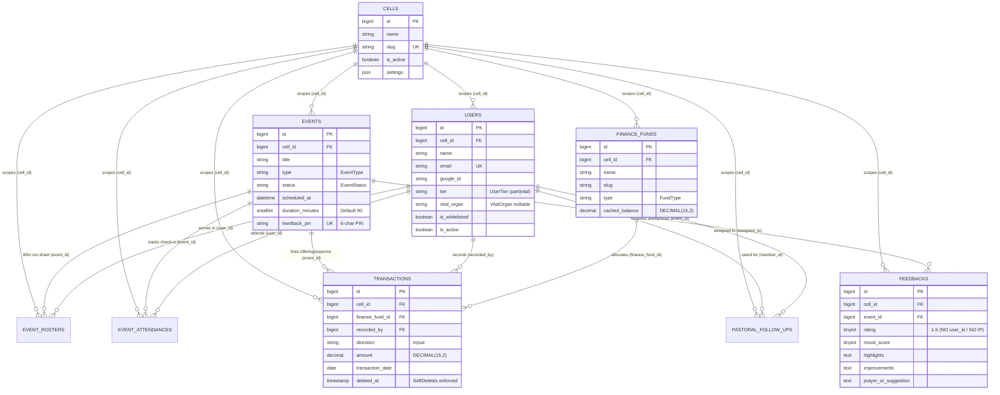

# FC R&D (Family Care — History Maker) System Architecture & ERD

## 1. Architectural Vision & Soft Multi-Tenancy

**FC R&D** is engineered for **Family Care — History Maker** starting with a single cell group (`FC R&D`, ~15–30 members) while embedding **Soft Multi-Tenancy (`cell_id`)** on every core domain table from Day 1. This allows the platform to scale horizontally to dozens of cell groups under *History Maker* without schema rewrites.

### Key Architectural Pillars
1. **cPanel Shared Hosting Native:**
   - **Zero Redis / Zero Supervisor / Zero Node SSR:** Sessions (`sessions`), Cache (`cache`), and Queues (`jobs`) use native MySQL drivers.
   - **Single Cron Entrypoint:** Background jobs and scheduled pastoral radar checks run through a single standard cPanel Cron Job (`* * * * * php /home/cpanel_user/app/artisan schedule:run >> /dev/null 2>&1`).
   - **Pre-Compiled Vite Assets:** Frontend assets (`React 19` + `TypeScript` + `Tailwind CSS v4`) compile locally into `public/build/manifest.json` so the production server requires zero Node.js runtime.
2. **100% Technical Anonymity (`feedbacks`):**
   - Stewarded by the **Nervous System (IT Team)**. The `feedbacks` table deliberately omits `user_id`, `ip_address`, `user_agent`, and browser fingerprint columns. Access is gated solely by a 6-character event PIN (`feedback_pin`).
3. **Immutable Financial Audit Trail (`transactions`):**
   - Stewarded by the **Vascular System (Treasurer)**. The `Transaction` model enforces Laravel `SoftDeletes` (`deleted_at`), blocks `forceDelete` via `TransactionPolicy`, and records every creation, update, or void action into `activity_log` via `spatie/laravel-activitylog`.

---

## 2. Domain Model: Journey of Belonging & The 5 Vital Organs

Every whitelisted member in `users` is assigned a **Journey of Belonging** tier (`App\Enums\UserTier`):
- **`part` (Part — Cell Member):** Members actively participating in weekly fellowship and spiritual growth.
- **`vital` (Vital — Core Servant):** Core servants stewarding one of the **5 Vital Organs** (`App\Enums\VitalOrgan`):
  1. 🧠 **`brain` — Brain (Leader):** Vision, teaching, & pastoral care (`vital:brain`).
  2. 🫁 **`lungs` — Lungs (Event Team):** Managing the rhythm and flow of the event (`90-minute run sheet`, `vital:lungs`).
  3. 🤲 **`hands_and_feet` — Hands & Feet (Hospitality Team):** Welcoming newcomers & reaching out to absent members (`vital:hands_and_feet`).
  4. 🫀 **`vascular_system` — Vascular System (Treasurer):** Managing virtual funds (`Kas Rutin`, `Dana Diakonia & Kado`, `Dana Acara Khusus`) & diaconate support (`vital:vascular_system`).
  5. ⚡ **`nervous_system` — Nervous System (IT Team):** Processing data, analytics, & anonymous feedback channels (`vital:nervous_system`).

---

## 3. Entity-Relationship Diagram (Phases 0–4 Incremental Schema)

